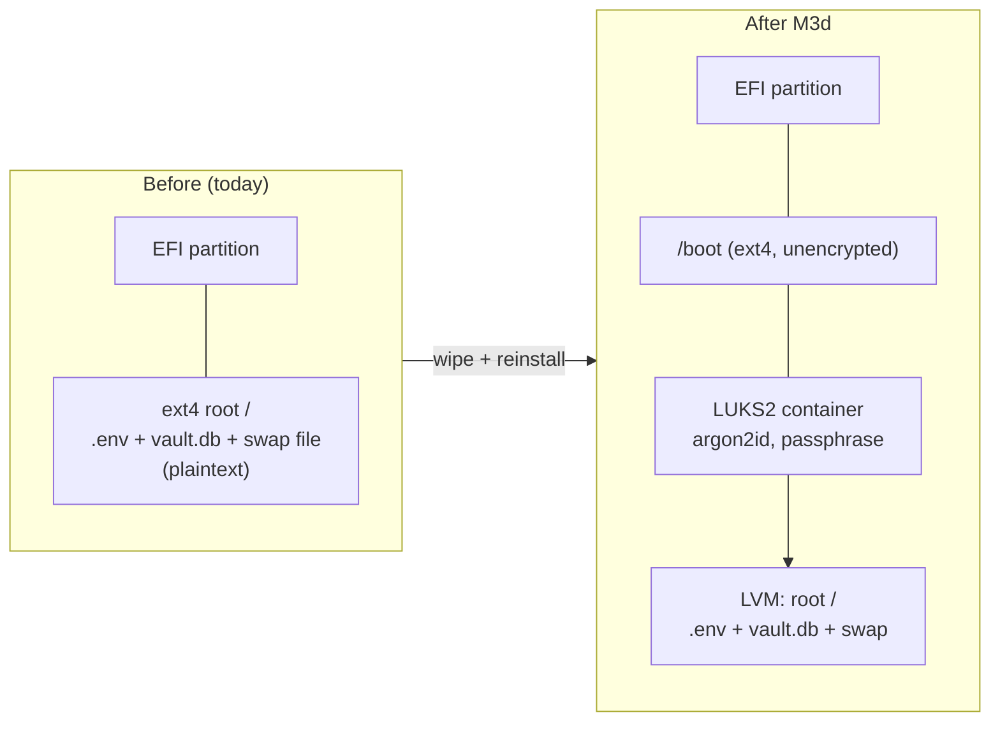

# M3d: Disk encryption (reinstall) — design and runbook

Status: **design, awaiting approval** (rebuilt 2026-11-08; the 2026-11-05 draft never reached GitHub).

## Why

The lab box (`cardinalXCareena`, HP Chromebook, 32 GB eMMC) has an unencrypted disk. `SecureVaultAPI/.env` holds the
Fernet key on that same disk, next to the database it protects (threat T6). Anyone holding the drive can read every
secret. M6 (split key) also depends on this: the machine share is only protected if the disk is.

## What changes



- Xubuntu 26.04.1 LTS, guided install, **Erase disk → Encrypt with a passphrase** (LVM on LUKS2). Older installer
  wording: *Advanced features → Use LVM and encryption*.
- Root, home and swap all live inside the LUKS container, so swapped-out memory is also encrypted.
- **No TPM unlock.** The Chromebook's security chip can't seal LUKS keys, so unlock is passphrase only, typed at boot.
- Firmware (MrChromebox UEFI) is not touched. The stock firmware backup on the Windows laptop stays the recovery path.

## Decisions (need approval)

| # | Decision | Recommendation | Why |
|---|---|---|---|
| D1 | Old vault data | **Discard.** Fresh `.env` key and empty DB after rebuild | It's test data. Copying the key to the Windows laptop to "save" it would put it on another unencrypted-or-unknown disk, the exact thing M3d removes |
| D2 | Remote unlock (dropbear-initramfs) | **No, not now** | Adds an SSH server to the pre-boot environment. Cost: after every reboot or power cut you must type the passphrase at the box |
| D3 | Passphrase | **5–6 random lowercase words, no symbols**, written on paper kept away from the laptop | The pre-boot prompt may use US layout; plain words type the same on any layout. Long words beat short complex strings |
| D4 | Identity | **Same user `cardinal`, same hostname `cardinalXCareena`** | `verify-hardening.sh`, sudoers and evidence docs all assume them. Same Wi-Fi MAC, so the Tenda IP-MAC binding keeps `192.168.0.103` |
| D5 | Installer image | **Full Xubuntu desktop ISO, not Xubuntu Minimal** | Launchpad bug 2063366: Minimal lacks `cryptsetup`, so LVM + encryption fails mid-install. Still open |

## Runbook

Each step ends with a checkpoint. Stop and report if a checkpoint doesn't match.

### Phase 0: Prepare (Windows laptop, nothing at risk)
1. Download the **Xubuntu 26.04.1 desktop** ISO and its `SHA256SUMS` from xubuntu.org.
2. PowerShell: `Get-FileHash .\xubuntu-26.04.1-desktop-amd64.iso -Algorithm SHA256`
   **Checkpoint:** the hash matches the line in `SHA256SUMS`.
3. Write it to an 8 GB+ USB stick with Rufus (partition scheme **GPT**, target **UEFI**).
4. Confirm the firmware backup still exists: `dir C:\backup\*.rom`
   **Checkpoint:** `BACKUP-CAREENA-Google_Grunt...rom`, 16 MB.
5. Write the passphrase (D3) on paper.

### Phase 1: Capture the "before" state (SSH from Windows to the box)
```bash
lsblk -f                                   # expect NO crypto_LUKS
sudo bash ~/chromebook-to-linux-lab/scripts/verify-hardening.sh ; echo "exit=$?"
ip -br link | grep -E '^wl'                 # note the Wi-Fi MAC
ls -la ~/SecureVault_Suite/SecureVaultAPI/.env ~/SecureVault_Suite/SecureVaultAPI/*.db 2>/dev/null
```
**Checkpoint:** `lsblk -f` shows plain `ext4` root and no `crypto_LUKS`; verify script exits 0. Paste the output: it
becomes the "before" half of the evidence.

### Phase 2: Install (at the box, USB keyboard)
1. Shut down. Plug in the installer USB. Power on and press **Esc** at the boot splash, then pick the USB in the boot menu.
2. Installer: language → keyboard (**English US**) → connect Wi-Fi → **Interactive installation**.
3. Disk setup: **Erase disk and install Xubuntu**. Target: the 29 GB eMMC (`mmcblk0`), **not** the USB stick.
4. Encryption: **Encrypt with a passphrase** (or Advanced features → LVM + encryption). Enter the D3 passphrase twice.
   If the installer shows a recovery key, write it next to the passphrase.
5. Account: name `cardinal`, computer name `cardinalXCareena`, strong login password, **Require my password to log in**.
6. Install, remove the USB when told, reboot.
   **Checkpoint:** before Xubuntu loads, a prompt asks for the disk passphrase; the correct one boots to the login screen.

### Phase 3: Prove the encryption (at the box)
```bash
lsblk -f                                    # root on a crypto_LUKS device, inside LVM
sudo cryptsetup luksDump /dev/mmcblk0p3 | grep -E 'Version|PBKDF|Cipher' | sort -u   # partition number may differ: use lsblk
swapon --show                               # swap path inside the encrypted root
```
**Checkpoint:** `Version: 2`, `PBKDF: argon2id`, cipher `aes-xts-plain64`; swap under `/`.
Then reboot and enter a **wrong** passphrase once. **Checkpoint:** it refuses and asks again.

Back up the LUKS header to a separate USB stick kept offline (not the Windows laptop):
```bash
sudo cryptsetup luksHeaderBackup /dev/mmcblk0p3 --header-backup-file /media/cardinal/<stick>/careena-luks-header.img
```

### Phase 4: Rebuild remote access (at the box, then from Windows)
1. `sudo apt update && sudo apt full-upgrade -y && sudo apt install -y openssh-server ufw git`
2. At the box, note the new host key: `ssh-keygen -lf /etc/ssh/ssh_host_ed25519_key.pub`
3. Windows: `ssh-keygen -R 192.168.0.103` (the old host key is gone, so this warning is expected), then
   `type $env:USERPROFILE\.ssh\id_ed25519.pub | ssh cardinal@192.168.0.103 "mkdir -p ~/.ssh && cat >> ~/.ssh/authorized_keys && chmod 700 ~/.ssh && chmod 600 ~/.ssh/authorized_keys"`
   **Checkpoint:** the fingerprint Windows shows on first connect matches step 2.
4. Re-apply the SSH drop-in (`PermitRootLogin no`, `PasswordAuthentication no`, `KbdInteractiveAuthentication no`) in
   `/etc/ssh/sshd_config.d/99-lab-hardening.conf`, `sudo sshd -t && sudo systemctl reload ssh`. **Keep this session
   open** and test a second login before closing it.
5. ufw: default deny inbound, SSH from `192.168.0.101` only. `sudo systemctl disable --now cups && sudo systemctl mask cups`.
6. `sudo apt install -y docker.io`.

### Phase 5: Redeploy SecureVault (from `main`)
Follow `deploy/firewall/README.md` as written, with a **new** key in `.env` (D1). Re-run the M3b brute-force test
from Kali (5×401 → banned → dropped, later 403).

### Phase 6: Done-when
- `lsblk -f` shows root on `crypto_LUKS`; the box won't boot without the passphrase.
- `verify-hardening.sh` exits 0; M3b checks pass again.
- Evidence (before/after) recorded in `docs/m3d-disk-encryption-evidence.md`; PLAN.md M3d ticked.
- Any step missing from the `chromebook-to-linux-lab` README gets added there (M3d is also a test of that runbook).

## What this does NOT protect (remaining exposure)

| Exposure | Status |
|---|---|
| A running, unlocked box | Not covered. Once booted, the disk is readable by anyone with a shell, and the `.env` key is still a file. M6 removes the key file |
| `/boot` and the EFI partition are unencrypted | Someone with physical access could tamper with the kernel/initramfs to capture the passphrase ("evil maid"). Accepted for a home lab; firmware hardening is M9 |
| Forgotten passphrase | Everything on the disk is lost for good. Acceptable: nothing irreplaceable lives on the box |
| Power cuts | With the battery disconnected, every power blip means a reboot that waits at the passphrase prompt until you type it (D2) |
| Header corruption | The offline header backup is the only recovery; without it a damaged header means total loss |
