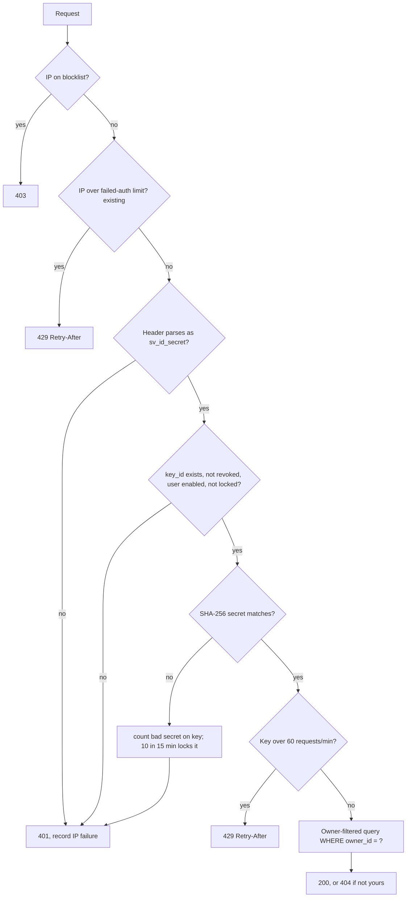
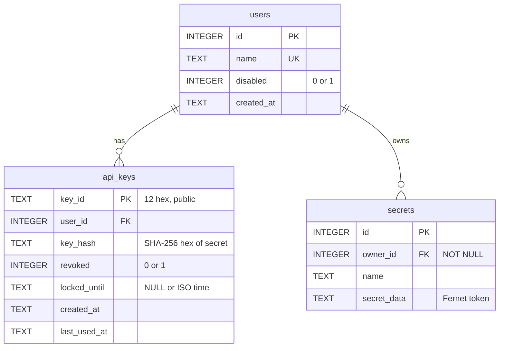

# M4: Per-user authentication (design)

Status: **approved 2026-11-06** (decisions D1–D6).
Closes threat T7: "One leaked API key exposes every secret; no per-user boundary."
Baseline: `pytest -q` on `main` at `d7641de` gives `59 passed` (verified 2026-11-06).

## 1. What changes, in one paragraph

The single shared `VALID_API_KEY` is replaced by per-user API keys. The server stores only a hash of each key. Each secret gets an owner, and every query filters on that owner, so one user can never read or overwrite another user's secret. A small CLI creates users and issues keys. An existing database is migrated in place, and its secrets are given to one owner. Limits are added per key (request rate, and a lockout after repeated bad secrets) on top of the existing per-IP limit. `add_secret` gets the type check it's missing.

## 2. Key format

```
sv_<key_id>_<secret>
   │         └─ 43 chars, secrets.token_urlsafe(32) = 256 random bits
   └─ 12 hex chars, secrets.token_hex(6), public, used to look the key up
```

- `key_id` is the lookup handle and is safe to log. `secret` is never stored or logged.
- Stored: `key_hash = SHA-256(secret)`, compared with `hmac.compare_digest`.
- The `sv_` prefix lets secret scanners (GitHub, gitleaks) spot a leaked key.

## 3. Request flow



Every 401 has the same body, `{"error": "Unauthorized"}`. Only the audit log says which check failed (`reason=unknown_key|bad_secret|revoked|disabled|locked|malformed`). LogSentinel still sees plain 401s, so the detect-and-block loop is unchanged.

## 4. Schema (v0 to v1)



- `secrets` changes from `UNIQUE(name)` to `UNIQUE(owner_id, name)`, so two users can each have `db_password`.
- `PRAGMA user_version` holds the schema version (0 = today's DB, 1 = M4).
- SQLite can't change a UNIQUE constraint in place, so the migration builds `secrets_new`, copies rows, drops the old table and renames, all in one transaction.
- Lockout state (`locked_until`) lives in the DB, so a restart doesn't clear it. The 60/min request rate stays in memory, like the existing IP limiter.

## 5. Decisions and why

| # | Decision | Why | Alternative rejected |
|---|---|---|---|
| D1 | SHA-256 for key hashes, not bcrypt/Argon2 | The secret is 256 random bits, so it can't be brute-forced, and a slow hash adds nothing. A slow hash costs about 50–100 ms of CPU per request, which makes floods cheaper for an attacker. No new dependency. | Argon2 (right for human passwords, wrong for random tokens) |
| D2 | One identical 401 for every auth failure | Doesn't tell an attacker whether a key ID exists, is revoked or is locked. Keeps LogSentinel unchanged. | Distinct 401/403/423 codes (leak state) |
| D3 | Someone else's secret gives 404, not 403 | 403 would confirm the name exists for another user | 403 |
| D4 | Hard cut off the shared key | Once `migrate` runs, `VALID_API_KEY` is ignored, and a startup warning appears if it's still set. Only you use the vault, so a dual-key period is attack surface that serves nobody. | A transition mode accepting both |
| D5 | Lockout: 10 bad secrets on one key in 15 min locks that key for 15 min (or until `key unlock`) | Stops guessing against a known key ID from many IPs. The existing per-IP limit (5/60s) catches a single IP first. | No per-key lock (leaves distributed guessing open) |
| D6 | Rate: 60 requests per minute per key | Contains a stolen key being used to dump the vault quickly | None |

## 6. Validation fix

`add_secret` requires `name` and `secret` to be non-empty strings. `name` is 1–128 chars from `[A-Za-z0-9_.-]`, and `secret` is at most 64 KB. Anything else gives `400`. Today a non-string `secret` gives a `500`.

## 7. Migration

`python vault_cli.py migrate --owner martin`:
1. Copies the DB to `test_vault.db.bak-<timestamp>`.
2. If `user_version` is 0: creates `users` and `api_keys`, rebuilds `secrets` with `owner_id`, assigns every row to `martin`, and sets `user_version = 1`. This runs in one transaction, so it rolls back on any error.
3. Issues martin's first key and prints it **once**.
4. If `user_version` is already 1, it does nothing and says so.

Secrets aren't re-encrypted. The Fernet key is unchanged, so old rows still decrypt.

## 8. CLI

`SecureVaultAPI/vault_cli.py` uses stdlib `argparse` and talks to the DB directly. Access control is the DB file's permission (after M3c, only the `securevault` user can write it).

| Command | Does |
|---|---|
| `migrate --owner NAME` | Upgrades the schema, assigns old secrets, issues the first key |
| `user create NAME` | Creates a user and prints their first key once |
| `user list` | Shows users, key IDs and status. Never hashes |
| `user disable NAME` | All their keys stop working immediately |
| `key issue NAME` | Issues an extra key (for rotating without downtime) |
| `key revoke KEY_ID` | Permanently kills one key |
| `key unlock KEY_ID` | Clears a lockout |

Every CLI action writes an `AUDIT action=cli_...` line to `app.log`.

## 9. Files

| File | Change |
|---|---|
| `SecureVaultAPI/keys.py` | **New.** Generates, parses and hashes keys |
| `SecureVaultAPI/schema.py` | **New.** Schema versions and the v0→v1 migration |
| `SecureVaultAPI/vault_cli.py` | **New.** The CLI above |
| `SecureVaultAPI/app.py` | Auth via users/keys, owner filter, validation, per-key limits; audit lines add `user=` and `key=` |
| `SecureVaultAPI/db_test.py` | Calls `schema.py` instead of its own `CREATE TABLE` |
| `SecureVaultAPI/.env.example` | Drops `VALID_API_KEY` |
| `tests/conftest.py` | Fixtures: `alice` and `bob`, each with a key |
| `tests/test_auth.py`, `test_ownership.py`, `test_migration.py`, `test_key_limits.py`, `test_cli.py` | **New** |
| `tests/test_api.py` | Existing tests switch from the shared key to alice's key. No test is deleted or weakened |
| `README.md`, `docs/threat-model.md`, `PLAN.md` | Endpoints table, auth section, T7 closed, M4 ticked |
| `LogSentinel/` | **No change.** The existing sentinel tests must still pass |

No new dependencies.

## 10. Tests that define "done"

These are written first and shown failing, then the code is built to pass them.

- **Auth:** a missing, malformed, unknown-ID, wrong-secret, revoked or disabled-user key gets the identical 401 body. A valid key gets 200. The stored hash isn't the secret. The full key never appears in `app.log`.
- **Ownership / IDOR:** Bob gets 404 for Alice's secret. Bob adding a secret with Alice's name leaves Alice's value unchanged. Both can hold the same name. A secret row always has an owner (NOT NULL enforced).
- **Migration:** a v0 DB with secrets upgrades to v1 with every secret owned and still decryptable. Re-running it changes nothing. The backup file is created. A failure mid-migration rolls back. The old shared key gets 401 afterwards.
- **Limits:** request 61 in a minute gets 429 with `Retry-After`, and the window slides. 10 bad secrets lock the key. A locked key with the *right* secret gets 401. The lock survives an app reload. `key unlock` clears it. One key's limits don't affect another key.
- **Validation:** a non-string, empty, oversize or badly named `name`/`secret` gets 400, never 500.
- **CLI:** each command's output and audit line. A key is printed only at creation.
- **Regression:** all 59 existing tests still pass, plus ruff, bandit (no new findings) and pip-audit.

## 11. Residual risks after M4 (go to the threat model)

- **Key lockout as denial of service.** Anyone who knows a key ID can lock that key with 10 bad attempts spread across IPs. The lock never touches data. This is flagged for the M7 audit.
- **Everyone with a key is equal** until M5 adds roles.
- **The encryption key is still in `.env` next to the DB** (T6) until M3d and M6.
- **The per-key rate limit is in memory, per process**, the same as the IP limiter. It resets on restart and isn't shared between gunicorn workers (M7).
- **The CLI trusts whoever can write the DB file.** That's fine on a single-user box, and M3c tightens the file ownership.
